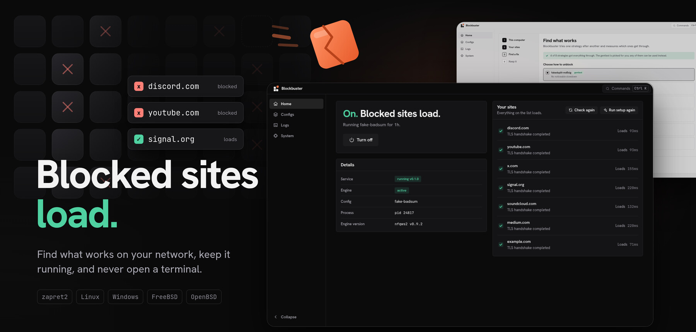

#  Blockbuster

[](https://github.com/dodoflix/blkbstr/actions/workflows/ci.yml)
[](https://github.com/dodoflix/blkbstr/releases)
[](LICENSE)

A desktop app for [zapret2](https://github.com/bol-van/zapret2). Check which sites your network blocks, let it find a strategy that gets them through, and keep it running in the background, without opening a terminal.

<p align="center"></p>

Start it (needs Rust, Node 22+ and the [Tauri dependencies](https://tauri.app/start/prerequisites/)):

```sh
npm install && npm run tauri dev
```

Or download a package from the [releases](https://github.com/dodoflix/blkbstr/releases) (Linux: apt, dnf and AUR in [docs/install-linux.md](docs/install-linux.md)). Running the engine also needs a small background service, plus `nftables` and a Lua runtime on Linux ([docs/development.md](docs/development.md) covers setting those up); the setup wizard installs zapret2 itself.

It walks you through checking your computer, testing which sites are blocked, trying strategies one by one and saving the one that works. Trial runs undo themselves unless you keep them, configs are portable JSON files, and nothing leaves your machine.

Also: a simple view by default and an advanced one with the real parameter file, light and dark themes, logs with one-click export, and a command palette on Ctrl+K.

- [Plan](docs/plan.md) and [architecture](docs/architecture.md)
- [Development](docs/development.md), [config format](docs/config-format.md) and [platform notes](docs/platform-notes.md)
- [Contributing](CONTRIBUTING.md), [security policy](SECURITY.md) and [releasing](docs/releasing.md)

Linux and Windows; the BSDs are planned. Use it only where the law and your network's rules allow it. See the [legal notice](LEGAL.md).
